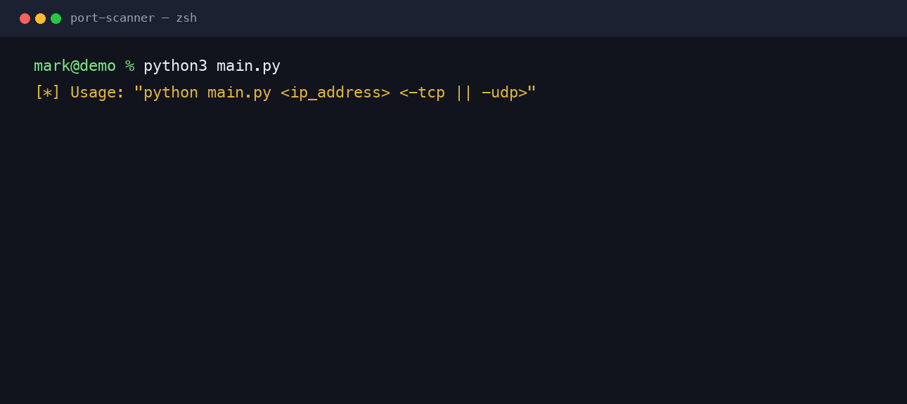
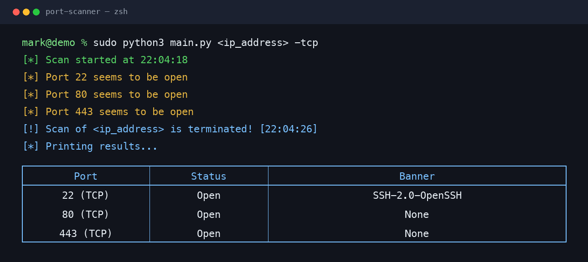

# Port Scanner

TCP SYN scanner for hosts you are allowed to test. It walks ports 1–65534, sends a SYN probe with Scapy, records ports that answer with SYN/ACK, then prints a table of open ports and their banners.

Use this only on systems you own or have written permission to assess.

<table>
  <tr>
    <td width="50%" align="center" valign="top">
      <a href="docs/usage.png">
        
      </a>
    </td>
    <td width="50%" align="center" valign="top">
      <a href="docs/scan.png">
        
      </a>
    </td>
  </tr>
</table>

<p align="center"><em>Click an image to zoom.</em></p>

## Features

- TCP SYN probe (`-tcp`)
- Banner grab for ports that appear open
- Colorized live progress and a final table
- IPv4 address validation before the scan starts

UDP mode (`-udp`) is reserved and not implemented yet.

## Requirements

- Python 3.10+
- The packages in `requirements.txt`
- Permission to send raw packets (often Administrator / root, plus Npcap or libpcap)

## How to use

```bash
python3 -m venv .venv
source .venv/bin/activate
pip install -r requirements.txt
sudo python3 main.py <ip_address> <-tcp || -udp>
```

Arguments:

| Argument | Meaning |
| --- | --- |
| `<ip_address>` | IPv4 host you are authorized to scan |
| `-tcp` | Run the TCP SYN scan |
| `-udp` | Reserved; not implemented yet |

When the run finishes, open ports are listed with protocol, status, and the first banner bytes returned by the service.

## License

GNU General Public License v3.0. See [LICENSE](LICENSE).
